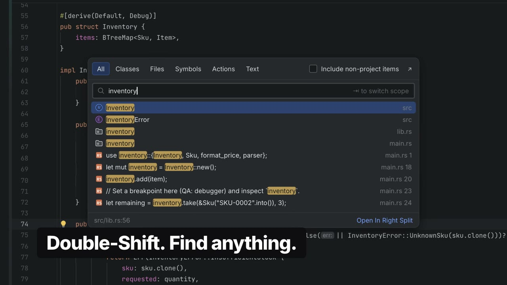

<p align="center">
  <picture>
    <source media="(prefers-color-scheme: dark)" srcset="src-tauri/icons/source/openidea-wordmark-dark.svg">
    
  </picture>
</p>

<p align="center">
  The IDE you know, rebuilt in Rust.
</p>

<p align="center">
  <a href="docs/media/openidea-promo.mp4">
    
  </a>
  <br>
  <sub><a href="docs/media/openidea-promo.mp4">▶ Watch the 50-second tour</a></sub>
</p>

<br>

OpenIDEA brings the IntelliJ IDEA way of working — its keymap, its tool windows,
its search-everything habits — to a native app with a Rust core.

Editor, code insight, debugger, Git, terminal, database and HTTP clients,
for 60+ languages.

## Build

```sh
pnpm install
pnpm tauri dev
```

Rust 1.96, Node 22, pnpm and the [Tauri prerequisites](https://v2.tauri.app/start/prerequisites/).

## License

[Apache 2.0](LICENSE). Bundled third-party assets are listed in [`THIRD_PARTY_LICENSES.md`](THIRD_PARTY_LICENSES.md).

<sub>Not affiliated with JetBrains. IntelliJ IDEA is a trademark of JetBrains s.r.o.</sub>
